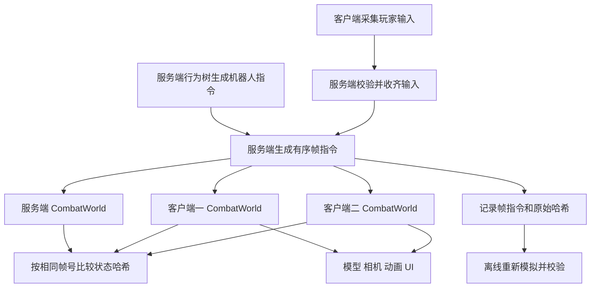

# UnityMOBA 手动实现大纲

本路线用于在 `UnityMOBA_Manual` 模板项目中，逐步手写代码、搭建场景和 Prefab，复现当前 `UnityMOBA` 的主要功能。每次完成一个可运行、可验证的小阶段，再进入下一阶段。

基线日期：2026-10-10。本文是学习与实施路线，不代表各阶段已经实施或通过验证，也不替代后续阶段的 Spec、设计和实现审批。

## 一、起点与最终目标

### 当前模板起点

| 项目 | UnityMOBA_Manual 当前状态 |
| --- | --- |
| Unity | 6000.3.23f1 |
| 渲染与输入 | URP 17.3.0、Input System 1.20.0；Active Input Handling 为 Input System |
| 测试包 | Test Framework 1.6.0 |
| 场景 | `Assets/Scenes/SampleScene.unity`，包含 Main Camera、Directional Light、Global Volume |
| 业务代码 | 尚无 MOBA 代码；只有模板 Readme 相关脚本 |
| 业务资产 | 尚无 Moba 场景、Prefab、行为树或 KayKit 角色资源 |
| 构建依赖 | 相比参考项目，manifest 缺少 Linux SDK 与交叉编译工具链条目；实际构建模块需另行检查 |

最终目标是一张单路地图：两名真人分属两队，每队另有一个机器人英雄、一座防御塔和周期生成的小兵；支持移动、普攻、Q 范围技能、死亡复活、出生区回复和摧塔结算。技术目标包括手写 FSM、服务端 Behavior Designer 行为树、20Hz 确定性帧同步、可靠 UDP、连续多局准备房间、回放校验、整数碰撞、英雄跟随镜头和 KayKit 动画。

以参考项目的[当前入口说明](../../UnityMOBA/README.md)、实际代码和最新功能记录为准。历史 Spec 中的 TCP、无碰撞、每局重启服务端等安排已经被后续功能替代。

### 手动复现的边界

- 自己创建业务脚本、程序集、场景、Prefab、配置和测试；参考项目用于阅读、比较行为和定位问题。
- Behavior Designer 和 KayKit 属于第三方依赖，可从已有合法资源导入，保留插件目录、原始素材和许可证。
- 暂时使用几何体、固定相机、本地命令驱动，都是学习过程中的中间状态；后续阶段会补齐最终行为。
- 不要求复刻每条历史开发路径。例如先用内存队列理解编帧，再实现当前 UDP，不必补写已经淘汰的 TCP 版本。
- 不增加装备、商城、多英雄技能体系、匹配系统、断线重连、观战、全局寻路或回滚预测。

## 二、始终保持的架构边界



1. **Core 是纯 C#。** 战斗位置用整数，参考项目中 1000 个逻辑单位对应 1 个 Unity 世界单位；逻辑固定为 20Hz。战斗计时使用帧号，渲染帧率不改变规则。
2. **输入表达意图。** 移动、攻击、施法都先变成命令；拾取射线可以使用 Unity，但只能输出量化坐标或实体 ID。
3. **服务端组织权威指令。** 三端运行相同战斗模拟；机器人英雄的行为树只在服务端评估。小兵和塔的确定性规则在各端 Core 中执行。
4. **表现读取逻辑。** Transform、Animator、PlayableGraph、Rigidbody、NavMeshAgent 和动画事件不能决定战斗位置或伤害。
5. **缺帧就等待。** 没有点击也要明确提交 NoOp；未收到输入不能自动当作 NoOp。超时使用真实经过时间，战斗计时仍使用逻辑帧。
6. **以逐帧哈希验证一致性。** 画面接近不能证明同步。回放重放命令，不重新生成 AI 决策，也不只是播放坐标轨迹。

参考项目采用独立 Server + 两个 Client，没有交付同时充当服务器和本地玩家的 Host 模式。`--host` 表示要连接的服务器地址，`UdpHost` 是传输监听器名称。后续验证表应明确记录 Host 模式不在复现范围内。

## 三、推进方式与阶段总览

每个新增功能阶段继续遵守项目的规范驱动流程：

1. 调查当前阶段相关代码和资源，在 `Docs/Specs/<编号>-<功能名>/spec.md` 写清目标、范围、约束、可验证的验收标准及未解决问题。
2. Spec 获批后编写 `design.md`；设计获批后生成 `tasks.md`，列出文件或 Unity 对象、需求编号、验证方式和任务状态。
3. 收到明确“批准实现”后开始实现。原项目的历史批准不自动视为模板项目的新阶段批准。
4. 每个小步骤完成后先消除编译错误，再验证当前行为；阶段结束在 `verification.md` 逐项登记“通过 / 失败 / 未验证”及证据。
5. 需要改变已批准规则时，先更新规范并说明原因。建议每阶段保留一个可回退的版本记录。

以下编号是学习顺序，**不是参考项目 Spec 编号**。后续可把相邻阶段合并成同一个功能 Spec，但保留分步验收。

已配套 16 篇详细教程，点击下表主题即可进入。建议从阶段 00 顺序阅读；每篇包含前置条件、文件与 Unity 对象的创建步骤、代码或算法说明、验证方法及排错提示。文档中的完整文件、局部片段和伪代码有明确标注，请先完成本阶段检查再继续。

| 阶段 | 主题 | 本阶段可见成果 | 状态 |
| --- | --- | --- | --- |
| 00 | [环境与工程骨架](00-环境与工程骨架.md) | 模板可运行，目录和测试入口准备好 | 未开始 |
| 01 | [整数逻辑世界与移动](01-整数逻辑世界与移动.md) | 不依赖场景也能执行移动指令 | 未开始 |
| 02 | [场景、单位显示与鼠标输入](02-场景单位显示与鼠标输入.md) | 右键让几何体英雄移动 | 未开始 |
| 03 | [战斗 FSM 与技能](03-战斗FSM技能与死亡复活.md) | 普攻、打断、技能、死亡复活 | 未开始 |
| 04 | [兵线、防御塔与胜负](04-兵线防御塔与胜负.md) | 本地完整单路对局 | 未开始 |
| 05 | [服务端行为树](05-BehaviorDesigner服务端AI.md) | 机器人进攻、施法、撤退和恢复 | 未开始 |
| 06 | [编帧与状态校验](06-编帧与状态校验.md) | 同进程三份世界逐帧一致 | 未开始 |
| 07 | [消息协议与可靠 UDP](07-消息协议与可靠UDP.md) | 可测试的有界可靠传输层 | 未开始 |
| 08 | [独立服务端与双客户端](08-独立服务端与双客户端.md) | 实际多进程帧同步对局 | 未开始 |
| 09 | [回放、诊断与故障处理](09-回放诊断与故障处理.md) | 离线重演并定位失败帧 | 未开始 |
| 10 | [英雄跟随相机](10-英雄跟随相机.md) | 两队各自跟随己方英雄 | 未开始 |
| 11 | [准备房间与连续多局](11-准备房间与连续多局.md) | 服务端不重启即可再次开局 | 未开始 |
| 12 | [确定性单位碰撞](12-确定性单位碰撞.md) | 单位阻挡、局部滑动和安全出生 | 未开始 |
| 13 | [KayKit 模型与动画](13-KayKit模型与动画.md) | 英雄、小兵具有对应模型和动作 | 未开始 |
| 14 | [英雄死亡表现](14-英雄死亡动画与尸体停留.md) | 尸体停留、死亡动画与复活重置 | 未开始 |
| 15 | [跨平台构建与完整验收](15-跨平台构建与完整验收.md) | Windows 客户端、Linux 服务端与验证记录 | 未开始 |

## 四、逐阶段实现大纲

下文参考文件均位于原 `UnityMOBA`。目录链接可直接打开对应源码；目标项目按相同职责逐步建立文件。当前源码已经集成后期功能，阅读时只提取本阶段需要的职责，避免照搬尚未具备依赖的完整类。

### 阶段 00　环境与工程骨架

**手动步骤**

1. 用 Unity 6000.3.23f1 打开模板，运行 SampleScene，记录 Console 基线；核对 URP、Input System 和测试包。保留仍被 ProjectSettings 引用的模板资源。
2. 建立 `Assets/Moba/Runtime`、`Editor`、`Tests/EditMode`、`Tests/PlayMode`、`Scenes`、`Prefabs`、`Config`、`Input` 等目录，以及 `Docs/Specs`。后续按需要补建 AI、Materials、Animations。
3. 先建立 `Moba.Core.asmdef` 和测试程序集，其他模块随实现加入。Core 设置 `noEngineReferences`；Editor、测试和运行时代码保持明确依赖方向。
4. 及早确认 Behavior Designer 安装包可用，并用最小测试树验证手动 Tick；及早确认 Windows Player 和 Linux Dedicated Server 构建模块，避免到最终出包才发现依赖缺失。

**参考**：[程序集与业务目录](../../UnityMOBA/Assets/Moba/Runtime)、[插件验证说明](../../UnityMOBA/Tools/PluginSmoke-README.md)。

**完成检查**：模板场景无编译错误；Test Runner 能识别测试程序集；插件或构建模块缺失有明确记录。这里只验证环境，不把空测试视为玩法通过。

### 阶段 01　整数逻辑世界与移动

**手动步骤**

1. 编写 `Int2`、`IntegerMath`、`BattleConfig`、`WorldState`，明确实体 ID、阵营、位置、帧号、随机种子和遍历顺序。
2. 编写 `CombatCommand`、`ActorCommand`、`FrameCommands`，先支持 NoOp 和 MoveTo；命令进入模拟前校验类型、边界和连续帧号。
3. 建立 `CombatWorld.Create/Step`，用固定每帧速度推进位置，处理到达目标、地图边界和整数舍入。先不实现单位间碰撞，阶段 12 再加入。
4. 在 EditMode 中用固定命令序列驱动世界，不依赖 MonoBehaviour、场景或真实键鼠。

**参考**：[Core](../../UnityMOBA/Assets/Moba/Runtime/Core) 中同名文件；`DeterministicMovementTests.cs`。

**完成检查**：NoOp 不改变已有移动意图；相同初态与命令产生相同结果；改变渲染帧率不改变逻辑移动结果；越界或跳帧输入按规则拒绝。

### 阶段 02　场景、单位显示与鼠标输入

**手动步骤**

1. 新建 `Assets/Moba/Scenes/MobaDemo.unity`，搭建地面、单路、出生区、光照和临时固定相机；创建几何体 `HeroView`、`RobotHeroView`、`MinionView`、`TowerView` Prefab。
2. 编写 `EntityView` 和 `BattleView`，用实体 ID 管理显示对象，并将整数位置换算为世界坐标；插值只影响显示。
3. 创建 `MobaInputActions.inputactions`：Point、Order、Select、Skill；编写 `PlayerCommandInput`，将右键地面转为 MoveTo，右键敌人转为 Attack，Q 转为 CastArea。战斗命令在阶段 03 启用。
4. 建立最小本地启动入口和 `BattleConfigAsset`，用 20Hz 驱动模拟。该入口是学习用的本地驱动，阶段 08 再接入正式网络会话。

**参考**：[Presentation](../../UnityMOBA/Assets/Moba/Runtime/Presentation)、[场景构造清单](../../UnityMOBA/Assets/Moba/Editor/MobaSceneBuilder.cs)。手动搭场景时用构造器核对对象及引用，不用一键生成代替搭建练习。

**完成检查**：右键可移动，位置显示与逻辑一致；点击 UI 不穿透为战斗指令；所有 Prefab 引用有效；修改显示 Transform 不会改变下一逻辑帧的权威位置。

### 阶段 03　战斗 FSM、技能与死亡复活

**手动步骤**

1. 编写 `CombatFsm`，建立 Idle、Moving、AttackWindup、Dead，明确 Enter/Tick/Exit；持续状态和计时存入可序列化的实体数据。
2. 增加追击、普攻前摇、命中帧和冷却。开始普攻时占用冷却；移动可以取消前摇，但不能返还冷却；命中时重新校验目标与距离。
3. 实现 Q 瞬时范围伤害、技能冷却、死亡抢占和英雄复活；死亡单位不能移动、攻击或施法。
4. 用 `SimEvent` 驱动血条、攻击提示和技能范围圈。此时无需骨骼动画。

**参考**：[Core](../../UnityMOBA/Assets/Moba/Runtime/Core) 的 `CombatWorld.cs`、`CombatFsm.cs`、`SimEvent.cs`；`CombatTests.cs`。

**完成检查**：前摇取消不伤害且冷却保留；死亡优先于存活行为；同帧多次伤害按固定顺序结算；冷却中不能重复施法；复活按逻辑帧触发。

### 阶段 04　兵线、防御塔、出生区与胜负

**手动步骤**

1. 增加 `LaneConfig`、`LaneRules`、`TargetSelector`：小兵按波次生成、沿路线推进、遇敌交战、目标失效后重选。
2. 增加塔的攻击规则及目标优先级，并限制兵量。参考默认值为每 300 帧一波、每队每波 3 个、每队最多 24 个小兵。
3. 实现出生区回复和受击后的回复延迟；摧毁敌方塔获胜，同帧双方塔均毁为平局，结束后停止正常战斗推进。
4. 从移动测试配置切换到完整对局配置。参考项目的 `new BattleConfig()` 默认是 MovementFixture，完整对局用 `BattleConfig.CreateDemo()` 或显式 Match 模式。

**参考**：[Core](../../UnityMOBA/Assets/Moba/Runtime/Core) 的兵线与选敌文件；`LaneRulesTests.cs`。

**完成检查**：至少完成一场真实摧塔对局；检查波次、单位上限、同帧胜负和回复中断。测试跑到帧数上限不等于已经验证胜负。

### 阶段 05　Behavior Designer 服务端 AI

**手动步骤**

1. 编写 `BlackboardAdapter`、`HeroCondition`、`HeroAction`，让节点读取逻辑状态并提交命令，不直接改位置、血量或 FSM。
2. 手动搭建 `Assets/Moba/AI/HeroDecision.asset`：死亡等待 → 低血撤退/回复 → 范围技能 → 攻击/追击 → 沿路推进；使用不同撤退与恢复阈值避免反复切换。
3. 创建 `ServerAiAgent.prefab`，挂载 BlackboardAdapter 和 BehaviorTree，绑定外部树；设置手动调度，并处理高优先级条件抢占。
4. 编写 `ServerAiRunner`、`ServerAiSystem`，参考项目每 4 个逻辑帧评估一次；先由本地权威驱动运行，联机时只由服务器创建。增加带帧号的 `AiTrace`。

**参考**：[AI 模块](../../UnityMOBA/Assets/Moba/Runtime/AI)、[行为树构造参考](../../UnityMOBA/Assets/Moba/Editor/MobaBuild.cs)、`HeroAiTests.cs`。

**完成检查**：机器人会撤退、回复后返回、施法和停止超距追击；每次评估每个机器人最多提交一条指令；等待输入时不重复评估；用真实节点变化验证行为树。

### 阶段 06　规范化状态、编帧与同进程一致性

**手动步骤**

1. 编写 `CanonicalStateWriter`、`StateHasher` 和配置编解码，固定字段顺序、实体排序和字节序；参考项目使用 SHA-256。
2. 校验覆盖影响后续战斗的状态：位置、生命、意图、FSM、冷却、复活、波次、实体 ID 分配和随机状态等；排除镜头、插值、UI、网络统计及行为树内部状态。
3. 实现 `InputWindow`、`FrameScheduler` 的最小版本：收齐两名玩家输入后，加入服务端 AI 指令，形成唯一的有序 `FrameCommands`。
4. 编写学习用内存队列/测试驱动，将同一帧指令送给三份独立 CombatWorld，比较每一帧哈希；这是新增练习夹具，不要求原项目存在同名实现。

**参考**：[状态校验实现](../../UnityMOBA/Assets/Moba/Runtime/Core/CanonicalStateWriter.cs)、[Networking](../../UnityMOBA/Assets/Moba/Runtime/Networking)；`StateHashTests.cs`、`FrameSchedulerTests.cs`。

**完成检查**：固定 6000 帧序列逐帧一致；修改未来会生效的冷却等字段可被发现；少一方输入时停帧，收到输入后恢复；重复与过期输入按规则处理。

### 阶段 07　消息协议与可靠 UDP

**手动步骤**

1. 先定义 `ProtocolMessages`、`MessageCodec`、`SessionWire` 和 `IMessageConnection` 边界，区分业务消息、完整消息编码和 UDP 数据报。
2. 依次实现数据报编码、握手/连接身份、序号窗口、ACK、去重、乱序重组和超时重传；随后加入分片重组、RTT/RTO、发送节奏及容量限制。
3. 建立 `UdpHost`、`UdpConnector` 和可靠业务通道；AI 观察快照使用独立的不可靠通道，旧快照丢弃且不阻塞战斗。
4. 使用模拟数据报测试逐项验证后，再接实际 Socket。参考约束包括 1200 字节 MTU、64 包窗口和有界消息队列；具体参数在本阶段设计中确认。

**参考**：[Transport](../../UnityMOBA/Assets/Moba/Runtime/Networking/Transport)、[UDP 设计](../../UnityMOBA/Docs/Specs/005-udp-transport/design.md)；`UdpTransportTests.cs`、`UdpBoundaryTests.cs`、`UdpWeakNetworkTests.cs`。

**完成检查**：丢包、重复、乱序、分片及序号回绕都有测试；已交付业务消息不重复；非法长度、伪造 ACK、旧连接包和队列溢出得到明确处理。可靠 UDP 是独立阶段，不能用“Socket 发收成功”代替完成验收。

### 阶段 08　独立服务端与两个客户端

**手动步骤**

1. 编写 `SessionServer`、`SessionClient` 及单局会话：连接、版本/配置检查、玩家槽位、初态确认、开始、等待、结束。先跑通单局，连续房间在阶段 11 完成。
2. 客户端只提交自己槽位的输入，包含 NoOp；服务端校验输入、收齐后评估 AI 并广播帧包。各端仅执行连续完整帧，向服务器报告对应帧哈希。
3. 用 `DemoBootstrap` 区分 server/client/replay 生命周期，服务端不创建客户端相机、输入和 HUD；客户端不创建 BehaviorManager 或机器人决策实例。
4. 完善启动场景引用，构建一个服务端进程和两个独立客户端，在本机地址完成实际联机。

**参考**：[Networking](../../UnityMOBA/Assets/Moba/Runtime/Networking)、[Bootstrap](../../UnityMOBA/Assets/Moba/Runtime/Bootstrap)、[基础同步测试工具](../../UnityMOBA/Tools/Run-DemoSmoke.ps1)。

**完成检查**：三端至少连续 600 帧哈希相同，再完成一场真实摧塔对局；检查版本不兼容、第三人加入、越权输入、等待恢复及断线结束。三个同进程世界测试不能替代多进程验证。

### 阶段 09　回放、诊断与故障处理

**手动步骤**

1. 实现 `ReplayWriter`、`ReplayReader`、`ReplayPlayer`、`ReplayPlayback`，保存配置、规则版本、种子、真人/AI 帧指令和逐帧哈希。
2. 从初始状态离线执行回放；提供暂停、倍速、校验结果和首个不一致帧；格式损坏、版本不兼容和记录不完整必须有明确结果。
3. 增加 `RunRecorder`、`FailureEvidence` 和 HUD：帧号、已验证帧、等待原因、AI 快照对应帧和 FSM 状态。
4. 分别注入输入延迟、短时断网、长时断网和单端状态篡改；开发测试注入默认关闭。

**参考**：[Replay](../../UnityMOBA/Assets/Moba/Runtime/Replay)、[Diagnostics](../../UnityMOBA/Assets/Moba/Runtime/Diagnostics)、[弱网脚本](../../UnityMOBA/Tools/Run-UdpWeakNetwork.ps1)；`ReplayTests.cs`、`SessionTests.cs`。

**完成检查**：同一记录在无网络、无行为树实例时逐帧校验通过；篡改能定位失败帧；短暂缺帧等待后恢复，持续失败结束；录像或轨迹播放不能替代模拟回放。

### 阶段 10　英雄跟随相机

**手动步骤**

1. 编写 `HeroFollowCamera`，斜俯视跟随自己的英雄；按阵营调整朝向，使双方各自朝右上方向进攻。
2. 处理出生、死亡、复活和窗口宽高比变化，并补足地图外背景。
3. 调试选择独立于控制和镜头绑定；选中机器人仅改变观察信息。

**参考**：[相机规范](../../UnityMOBA/Docs/Specs/002-hero-follow-camera/spec.md)、[HeroFollowCamera.cs](../../UnityMOBA/Assets/Moba/Runtime/Presentation/HeroFollowCamera.cs)、`HeroFollowCameraTests.cs`。

**完成检查**：两个实际客户端各自跟随本方英雄；死亡/复活不丢失绑定；选敌或选机器人不切换控制对象；镜头变化不影响状态哈希。

### 阶段 11　准备房间与连续多局

**手动步骤**

1. 引入 `RoomState`、`RoomWire`，实现加入、准备、取消准备、离开；成员变化清空准备状态，双方准备后校验初态并倒计时。
2. 分离长寿命连接与单局 `ServerMatchSession/ClientMatchSession`、`MatchRuntime`；结算、退出或失败后清理单局资源并返回房间。
3. 隔离房间修订、准备轮次、局号和旧局消息；每局记录独立目录，避免覆盖回放；磁盘不可写时禁止开始新局。
4. 在同一服务端进程中连续开局，覆盖倒计时退出、战斗退出、补位和再次准备。

**参考**：[房间设计](../../UnityMOBA/Docs/Specs/003-persistent-ready-room/design.md)、[房间测试工具](../../UnityMOBA/Tools/Run-RoomLifecycle.ps1)；`RoomSessionTests.cs`、`RoomProtocolTests.cs`、`RoomResourceTests.cs`。

**完成检查**：正常结束保留连接并可再次准备；离开中止当局，剩余玩家回房；十轮混合流程中无旧输入污染，AI、显示对象和事件订阅均按局释放；服务器监听器不随每局重建。

### 阶段 12　确定性单位碰撞

**手动步骤**

1. 实现 `CollisionConfig`、`CollisionGeometry`、`CollisionWorld` 和 `CollisionMovement`：整数圆形体积、固定处理顺序、分步移动及局部滑动。
2. 所有存活英雄和小兵互相阻挡，塔作为固定障碍；处理边界、点击障碍内部、迎面移动、拥堵，以及碰撞半径下的攻击距离。
3. 实现 `SpawnPlacement`：出生和复活不得重叠；无位置时英雄延迟复活，小兵跳过无法放置的数量。死亡单位不阻挡。
4. 将新增战斗配置和必要状态纳入哈希及回放版本；表现沿合法移动路径插值，增加可切换的逻辑碰撞圆调试显示。

**参考**：[碰撞设计](../../UnityMOBA/Docs/Specs/004-deterministic-unit-collision/design.md)、[Core 碰撞文件](../../UnityMOBA/Assets/Moba/Runtime/Core)；`CollisionTests.cs`、`CollisionPresentationTests.cs`。

**完成检查**：同队与敌队均阻挡；不穿塔、不越界、不因滑动加速；拥堵出生安全；三端和新规则回放一致。改变规则后重新生成并验证回放，旧无碰撞回放应明确拒绝。局部滑动不承诺全局绕路或推挤。

### 阶段 13　KayKit 模型与动作

**手动步骤**

1. 导入 Adventurers、Skeletons、CharacterAnimations 并保留许可证；玩家选 Knight、机器人选 Barbarian、小兵选 Skeleton_Minion。
2. 创建 `UnitVisualProfile` 与派生动画/材质资源，在既有单位 Prefab 上挂载模型、武器、阵营环和血条；保持逻辑实体 ID、坐标与网络流程。
3. 编写 `UnitVisual`，按逻辑显示时间手动采样 PlayableGraph，映射待机、实际移动、普攻和施法，处理朝向与混合。
4. 网络等待最多显示到已知逻辑帧末；回放暂停与倍速同时约束动画。禁用 Root Motion 对逻辑位置的影响，伤害仍由 Core 结算。

**参考**：[模型使用说明](../../UnityMOBA/Docs/Specs/006-kaykit-unit-visuals/usage.md)、[UnitVisual.cs](../../UnityMOBA/Assets/Moba/Runtime/Presentation/UnitVisual.cs)、[资源生成参考](../../UnityMOBA/Assets/Moba/Editor/KayKitVisualBuilder.cs)。

**完成检查**：模型、材质、武器挂点和阵营识别正确；移动/攻击/施法切换符合逻辑；双客户端画面可核对，哈希和既有回放结果不因纯表现替换而改变。

### 阶段 14　死亡动画与尸体停留

**手动步骤**

1. 为玩家和机器人英雄接入 Death_A；死亡表现优先级最高，只记录一次死亡起始显示时间。
2. 动画结束后固定最后姿势，尸体停留在死亡地点；关闭血条、阵营环和拾取 Collider。
3. 逻辑复活时复用显示对象、重置动作并回到出生点；再次死亡可重新播放；回房和退出时销毁显示资源。小兵继续沿用死亡移除。

**参考**：[死亡表现记录](../../UnityMOBA/Docs/DeathVisuals.md)、`UnitVisual.cs`、`EntityView.cs`、`DeathVisualTests.cs`。

**完成检查**：死亡不再被选中或攻击；尸体不被重复快照拉回站姿；暂停时动作停住；复活、第二次死亡和回房清理均正确；观察实际蒙皮网格而不只检查骨骼数据。

### 阶段 15　跨平台构建、发布材料与完整验收

**手动步骤**

1. 建立引用校验与构建工具，显式把 `Assets/Moba/Scenes/MobaDemo.unity` 设为入口。两个项目当前 EditorBuildSettings 都仍列 SampleScene，不能直接用默认列表假定打包到游戏。
2. 构建 Windows 客户端和 Linux Dedicated Server；更新脚本中的项目根、Unity 路径、日志和产物目录，确保全部指向 Manual。
3. 运行 Linux 服务端加两个 Windows 客户端，检查 UDP 端口、不同系统逐帧哈希、完整胜负、回房再开局及离线回放。
4. 整理运行说明、测试证据、示例回放和第三方许可证；准备 3—5 分钟演示，讲清 FSM、AI、帧同步、失败处理及局限。

**参考**：[Tools 索引](../../UnityMOBA/Tools/README.md)、[MobaBuild.cs](../../UnityMOBA/Assets/Moba/Editor/MobaBuild.cs)、[ReferenceValidator.cs](../../UnityMOBA/Assets/Moba/Editor/ReferenceValidator.cs)。

**完成检查**：记录真实编译、EditMode/PlayMode、引用、多进程和跨平台结果；人工操作双客户端检查鼠标输入、准备按钮、相机和回放控制。没有 Linux 运行环境时，将运行验证标为未验证，不能用构建通过代替。公网直连与本机/隧道测试分别记录。

## 五、目标目录与手动搭建重点

```text
Assets/Moba/
  Runtime/
    Core/           整数战斗状态、FSM、兵线、碰撞、状态哈希
    AI/             Behavior Designer 适配与服务端决策
    Networking/     协议、编帧、会话与房间
      Transport/    UDP 数据报、可靠层、握手与统计
    Replay/         记录、读取、重演与校验
    Presentation/   输入、显示、相机、HUD 与动画
    Bootstrap/      配置资产、启动与生命周期
    Diagnostics/    开发验证用故障注入
  Editor/           引用检查、构建及资源工具
  Tests/
    EditMode/
    PlayMode/
    Fixtures/
  Scenes/           MobaDemo.unity
  Prefabs/          ClientPresentation、HUD、单位和 ServerAiAgent
  Config/           BattleConfig 与角色表现配置
  AI/               HeroDecision.asset
  Input/            MobaInputActions.inputactions
  Materials/
  Animations/
Docs/
  手动实现大纲.md
  Specs/
Tools/              逐步建立验证与构建脚本
```

目录不必一次填满。Core、Networking、Replay 和 Diagnostics 保持纯 C#；AI 依赖 Core 和插件，Presentation 依赖 Core、Networking 和 Input System，Bootstrap 最后负责组合模块。

最终场景搭建重点：

| Unity 对象 | 需要理解并手动连接的职责 |
| --- | --- |
| Bootstrap | DemoBootstrap 绑定 BattleConfig、ServerAiAgent、ClientPresentation 和 HUD |
| ClientPresentation | BattleView、PlayerCommandInput、HeroFollowCamera、相机、光照及地图显示；只在需要画面的模式创建 |
| 各单位 Prefab | EntityView 负责实体绑定，UnitVisual 负责后期动作；逻辑碰撞与拾取 Collider 职责分开 |
| ServerAiAgent | BlackboardAdapter + BehaviorTree + HeroDecision；仅由权威驱动/服务器创建 |
| HUD | DemoHud 显示房间、战斗、同步和观察信息；参考项目 HUD 使用代码绘制，首轮无需另做复杂 UI 框架 |

手动创建资源让 Unity 生成和维护引用；需要导入第三方资源时连同其关联资产与元数据处理，不整目录覆盖模板的 ProjectSettings。参考生成脚本可以作为“最终应有哪些组件和引用”的核对清单。

## 六、里程碑与最终验收清单

- **里程碑 A：阶段 00—05。** 能自己解释并修改一个本地单路战斗，机器人由行为树产生指令、FSM 执行。
- **里程碑 B：阶段 06—09。** 两个实际客户端与服务端逐帧一致，故障可观察，完整记录可离线校验。
- **里程碑 C：阶段 10—14。** 跟随镜头、连续房间、碰撞和模型表现补齐当前参考功能。
- **里程碑 D：阶段 15。** 取得跨平台运行与人工操作证据，形成可交付演示。

最终在对应 `verification.md` 中逐项确认：

- [ ] 所有批准需求已实现，文档与当前代码一致。
- [ ] Unity 编译通过，无本次实现引入的 Console 错误。
- [ ] 相关 EditMode、PlayMode 测试通过，场景与 Prefab 引用有效。
- [ ] 独立 Server 和 Client 启动路径有效；Host 模式明确标为不在范围内。
- [ ] 至少两个实际客户端联机，服务端与两客户端逐帧哈希一致。
- [ ] 客户端不能控制其他玩家或运行服务器专属 AI 决策。
- [ ] 完整摧塔、死亡复活、连续多局、离开补位均已验证。
- [ ] 延迟、丢包、断线、哈希不一致和记录失败具有可观察处理。
- [ ] 完整对局回放逐帧通过，版本不兼容与损坏记录被明确拒绝。
- [ ] Linux 服务端与 Windows 客户端实际运行证据已记录。
- [ ] 双客户端人工操作与视觉检查已记录；自动测试不冒充人工试玩。
- [ ] 未执行项写明原因与影响，不标为通过。

建议第一次实际动手只推进阶段 00 和阶段 01：先具备可重复运行的整数移动世界，再进入场景显示和战斗状态机。
